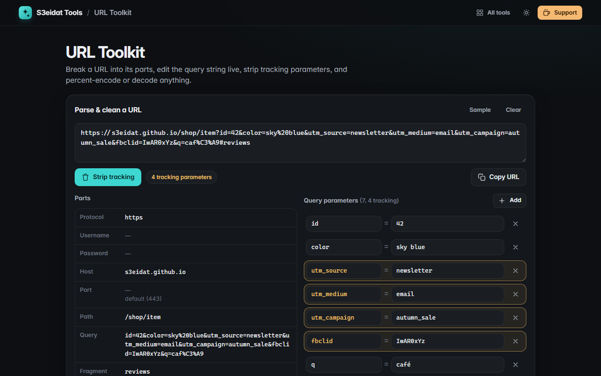

# URL Toolkit

> Encode, decode and break down URLs, edit query parameters, and strip tracking. Free, private, and it runs entirely in your browser.

### ▶ [Open URL Toolkit](https://s3eidat.github.io/url-toolkit/)



## Features

- **Parse** any URL into protocol, username, password (masked), host, port (with the default shown), path,
  query, fragment and origin, with decoded versions of the path and fragment
- **Edit query parameters** in a table (add, change, remove) and the URL is rebuilt live;
  order, duplicate keys and value-less flags are preserved
- **Strip tracking** in one click: `utm_*`, `fbclid`, `gclid`, `msclkid`, `dclid`, `gbraid`, `wbraid`, `mc_cid`,
  `igshid`, `yclid`, `ttclid`, `_ga`, `_gl`, HubSpot and Marketo tokens, and more; tracking keys are highlighted
- **Encode / decode** with `encodeURIComponent` (component) or `encodeURI` (full URL), optional `+` as space for
  form data, and a clear error for malformed `%` sequences
- Copy buttons everywhere; URLs without a scheme get `https://` assumed

The page never opens, fetches or previews the URLs you paste.

## Privacy

Nothing is sent anywhere. There is no server, no account, no analytics.
The page ships with a strict Content-Security-Policy (`connect-src 'self'`), so the browser
itself blocks any attempt to send data anywhere.

## Run it yourself

It's plain HTML, CSS and JavaScript with no build step:

```bash
git clone https://github.com/s3eidat/url-toolkit
cd url-toolkit
python -m http.server 8000
```

Then open http://localhost:8000.

## Support

If this saved you time, **[buy me a coffee ☕](https://s3eidat.github.io/coffee/)**. It keeps every tool free.

---

Part of **[S3eidat Tools](https://s3eidat.github.io/)**: 100+ free, private tools that run in your browser. MIT licensed.
